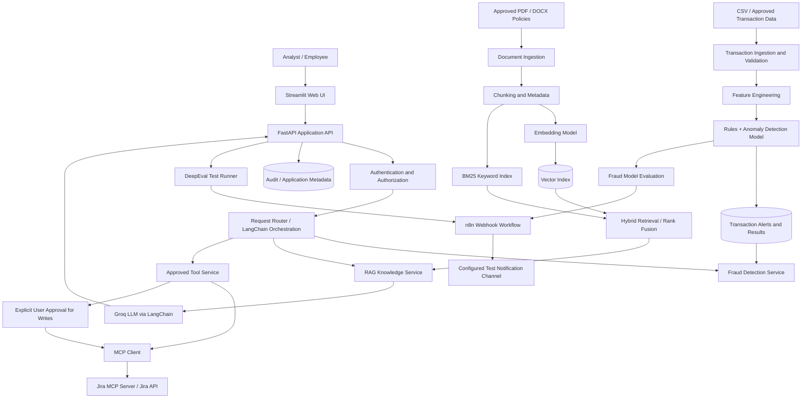

# KnowledgeOps AI — System Architecture

> **Project:** KnowledgeOps AI — Intelligent Fraud Detection and Enterprise Knowledge Assistant  
> **Document type:** High-Level Design (HLD) / Architecture  
> **Status:** Initial architecture proposal  
> **Version:** 0.1  
> **Date:** 2026-10-21

## 1. Project Overview

KnowledgeOps AI is an AI-powered application that combines suspicious-transaction detection with an enterprise knowledge assistant. It analyzes transaction data to flag unusual activity for human review, retrieves relevant policies and investigation procedures using Retrieval-Augmented Generation (RAG), and generates evidence-grounded explanations using a Groq-hosted language model orchestrated through LangChain.

The application can connect to Jira through the Model Context Protocol (MCP) to search for existing investigation issues and, after explicit user approval, create a new case. n8n automates selected notifications and follow-up workflows. DeepEval evaluates the retrieval and generated-answer components, while fraud-model metrics assess the detection component.

**Important boundary:** A flagged transaction is a signal for investigation, not proof of fraud. The prototype will not automatically accuse a person, block a transaction, or take other high-impact action.

## 2. Problem Statement

Enterprise policies, technical guidance, transaction information, and investigation records are often spread across different systems. Analysts may need to manually inspect unusual transactions, search policies, and create follow-up cases. A generic chatbot may also produce unsupported explanations, while a fraud model alone may identify anomalies without explaining the relevant organisational procedure.

KnowledgeOps AI aims to bring these tasks into one workflow: detect potentially suspicious activity, present the indicators, retrieve relevant policy evidence, support a human-led investigation, and record approved follow-up actions.

## 3. Project Objectives

- Build a working prototype that ingests a controlled set of transaction records and flags suspicious patterns.
- Implement a document ingestion and RAG pipeline for approved policies and investigation guides.
- Compare a vector-search baseline with BM25/vector hybrid retrieval.
- Generate explanations grounded in model outputs and retrieved evidence.
- Integrate one Jira MCP workflow for issue search and approval-gated case creation.
- Use n8n for one verifiable notification workflow.
- Evaluate fraud detection and RAG quality with appropriate, separate metrics.
- Apply basic access control, secret management, and audit logging.

## 4. Scope

### In scope

- Synthetic or otherwise explicitly approved transaction data.
- CSV ingestion for the first prototype.
- Basic feature engineering and a transparent rule-based baseline.
- An anomaly detector such as Isolation Forest; supervised learning is optional and depends on suitable labelled data.
- PDF and DOCX policy documents.
- Chunking, embeddings, vector retrieval, BM25, and reciprocal rank fusion.
- Groq API integration through LangChain.
- Source references in knowledge answers.
- A Streamlit user interface and FastAPI backend.
- Jira issue search and approval-gated issue creation through an available MCP server.
- One n8n notification workflow.
- DeepEval tests for RAG, plus fraud-detection evaluation where ground-truth labels exist.
- Documentation, reproducible setup, and a demonstration dataset.

### Out of scope for the initial prototype

- Production banking or payment processing.
- Automatically blocking transactions or taking enforcement action.
- Claims that anomaly scores are calibrated fraud probabilities unless calibration is tested.
- Autonomous Jira write actions without user approval.
- Large-scale streaming infrastructure, multiple agent systems, or numerous external integrations.
- Use of confidential company data without explicit authorisation.

## 5. Architecture Principles

1. **Modular design:** Keep fraud detection, retrieval, generation, integrations, and UI as separate components.
2. **Evidence-grounded answers:** The assistant should cite retrieved sources and acknowledge when evidence is missing.
3. **Human oversight:** A person reviews fraud alerts and approves case creation.
4. **Least privilege:** Each user and integration receives only the access required for its task.
5. **Traceability:** Store sufficient metadata to trace an alert, its model version, retrieved sources, and approved tool actions.
6. **Measurable quality:** Evaluate fraud detection and RAG separately; do not treat an LLM score as a fraud-model metric.
7. **Replaceable components:** Keep model providers, vector stores, and MCP implementations behind clear interfaces where practical.

## 6. High-Level Architecture



### Architecture flow notes

- A document question uses the RAG path; a transaction analysis request uses the fraud service; an investigation request may combine both.
- The fraud detector returns a result and indicators. The LLM explains those outputs but does not independently determine whether a transaction is fraudulent.
- RAG retrieves policies and procedures, not transaction truth. Transaction data and detector outputs must come from their respective services.
- Jira tool calls must be validated and authorised server-side. Writes require a visible approval step.
- DeepEval and fraud-model evaluation are primarily test/reporting workflows, not necessarily part of every live user request.
- n8n receives selected events, such as a completed evaluation run or an approved case event.

## 7. Main Components

| Component | Responsibility | Suggested implementation |
|---|---|---|
| Web UI | Upload files, ask questions, review alerts, view sources and approve actions | Streamlit |
| API | Expose application endpoints and coordinate services | FastAPI |
| Orchestration | Route requests, manage prompts, retrieval calls and tool selection | LangChain + Python |
| Transaction ingestion | Validate CSV schema, types, missing values and duplicates | pandas + Pydantic |
| Fraud detection | Apply baseline rules and flag anomalous patterns | Python + scikit-learn Isolation Forest |
| Fraud evaluation | Assess model quality when labels exist | scikit-learn metrics |
| Document ingestion | Extract text and metadata from PDF/DOCX | PyMuPDF + python-docx |
| Chunking and embeddings | Create retrievable document segments and vectors | Python + sentence-transformers |
| Vector retrieval | Retrieve semantically similar chunks | FAISS initially; pgvector is an alternative |
| Keyword retrieval | Match exact terms, identifiers and phrases | BM25, e.g. rank-bm25 |
| Hybrid ranker | Combine ranked results | Reciprocal Rank Fusion (RRF) |
| Answer generation | Produce evidence-grounded explanations | Groq API + LangChain |
| Tool integration | Search issues and create approved investigation cases | MCP client + compatible Jira MCP server |
| Evaluation | Test retrieval and answer quality | DeepEval |
| Workflow automation | Send evaluation/alert notifications | n8n |
| Persistence | Store metadata, alert records, test runs and audit events | SQLite for local prototype; PostgreSQL if shared |
| Version control | Collaborate and track changes | Git + GitHub |

**Selection note:** FAISS is suitable for a local first version; use PostgreSQL/pgvector if shared persistence and metadata filtering are needed. Confirm compatibility and access for the chosen Groq model, embedding model, DeepEval evaluator, and Jira MCP server before implementation.

## 8. Core User Workflows

### Workflow A — Detect and investigate a suspicious transaction

1. An authorised user uploads a synthetic or approved transaction CSV.
2. The ingestion layer validates required fields and reports malformed rows.
3. Feature engineering prepares the inputs expected by the detector.
4. Rules and/or the anomaly model produce a result with the relevant indicators.
5. The UI displays the alert as **flagged for review**, including the transaction reference and explanation of indicators.
6. The user asks the assistant what the organisation's policy says to do next.
7. RAG retrieves relevant policy sections; the LLM provides a sourced summary.
8. The application checks Jira for a related existing case.
9. If a new case is appropriate, the user reviews and approves the proposed Jira issue.
10. The system records the result and emits a selected event to n8n for notification.

### Workflow B — Ask an enterprise knowledge question

1. The user asks a question in the UI.
2. The backend retrieves relevant chunks using vector and BM25 search.
3. The ranker combines results and returns the top context.
4. LangChain supplies the question and context to Groq.
5. The assistant returns an answer with source references or says that the available evidence is insufficient.
6. A test run can evaluate the retrieval and answer using DeepEval.

### Workflow C — Evaluate and notify

1. A developer or analyst runs a fixed evaluation dataset.
2. DeepEval records configured RAG metrics; the fraud evaluation script records appropriate classification metrics when labels are available.
3. The application sends a compact, non-sensitive summary to an n8n webhook.
4. n8n logs the event and sends a configured notification.
5. The result can be reviewed during the capstone demonstration.

## 9. Fraud Detection Design

### Initial approach

Start with a transparent rule-based baseline and an unsupervised anomaly detector. Add a supervised classifier only if the group obtains a suitable labelled dataset and can evaluate it responsibly.

Potential synthetic features include:

- Transaction amount.
- Hour of transaction.
- Transaction count over a recent time window.
- Distance from a usual location, if available and appropriate.
- Whether a device is new.
- Historical account activity summaries.

These are candidate features, not proof of fraud. Only include fields that exist in the selected dataset and are appropriate for the intended use.

### Output contract

A detection result should include:

- `transaction_id`
- `model_version`
- `anomaly_score` or `risk_score`
- `flagged_for_review`
- `indicators` (human-readable features/rules that contributed)
- `created_at`
- `review_status`

Do not label an anomaly score as a fraud probability unless a calibration method and validation support that interpretation.

### Evaluation

If reliable labels exist, report precision, recall, F1-score, precision-recall AUC, confusion matrix, and false-positive rate at a chosen threshold. For imbalanced datasets, accuracy alone is not sufficient. If labels do not exist, report the limits of unsupervised evaluation and manually review a sample of flagged records; do not claim a verified fraud-detection rate.

## 10. RAG and DeepEval Design

### Ingestion pipeline

1. Load approved PDF and DOCX files.
2. Extract text and source metadata.
3. Split content into chunks; compare a baseline splitter with semantic chunking if time allows.
4. Generate embeddings with a single consistent embedding model.
5. Store vectors and chunk metadata in the vector index.
6. Build a BM25 index from the same corpus.
7. Retrieve from both systems and combine rankings with RRF.
8. Pass the top-ranked context to the LLM with instructions to stay within the evidence.

Each chunk should preserve document ID, title, version, section/page where available, access level, and source location so citations can be rendered accurately.

### Evaluation metrics

- **Contextual Recall:** whether retrieved context covers the information needed by the reference answer.
- **Contextual Precision:** whether relevant context is ranked above irrelevant context.
- **Contextual Relevancy:** how relevant the retrieved context is to the question.
- **Faithfulness:** whether the answer is supported by the supplied context.
- **Answer Relevancy:** whether the answer addresses the user's question.

Use a versioned dataset of approximately 30–50 initial questions. Compare vector-only retrieval with hybrid retrieval on the same test set and settings. Report actual measurements; do not fabricate results or assume hybrid retrieval will always improve every metric.

## 11. Jira MCP and n8n Integration

### Jira

Initial tools:
- Search for existing issues.
- Retrieve issue details.
- Create a proposed investigation issue only after an explicit approval step.

Security controls:
- Use a dedicated account or token with minimum required permissions.
- Keep credentials in environment variables or an approved secrets store; never commit them.
- Validate all tool arguments server-side.
- Log who initiated and approved a write action.
- Treat issue descriptions and retrieved content as untrusted input.
- Never allow retrieved document instructions or LLM output to bypass authorization.

If live Jira access is unavailable, implement a clearly labelled mock adapter so the UI workflow can still be tested. Do not present mock results as live Jira results.

### n8n

Implement one workflow first:
1. FastAPI sends an event to an authenticated n8n webhook after an evaluation run or approved case event.
2. n8n validates the event and checks its status/threshold.
3. n8n logs the result and sends a message to an available test notification channel.
4. The workflow outcome is visible for demonstration.

Avoid sending full transaction records or sensitive personal data to n8n when a transaction reference and minimal status will suffice.

## 12. Data Model (Initial)

| Entity | Purpose | Example fields |
|---|---|---|
| `documents` | Track source documents | `document_id`, `title`, `version`, `access_level` |
| `document_chunks` | Store searchable chunks and metadata | `chunk_id`, `document_id`, `text`, `embedding_ref`, `source_location` |
| `transactions` | Store imported transaction metadata | `transaction_id`, selected features, `ingestion_batch_id` |
| `fraud_alerts` | Store detection results | `alert_id`, `transaction_id`, `model_version`, `anomaly_score`, `review_status` |
| `conversations` | Track sessions | `conversation_id`, `user_id`, `created_at` |
| `messages` | Store chat messages as permitted | `message_id`, `conversation_id`, `role`, `content` |
| `evaluation_runs` | Record evaluation results | `run_id`, `dataset_version`, `metric_name`, `score` |
| `tool_audit_logs` | Record tool actions | `execution_id`, `user_id`, `tool_name`, `status`, `approved_by`, `timestamp` |

The initial prototype may use SQLite for local metadata storage. Choose PostgreSQL if the team needs shared persistence, concurrent access, or more advanced filtering. Avoid storing unnecessary personal or financial information.

## 13. API Sketch

Initial endpoints (names can be refined during implementation):

| Method | Endpoint | Purpose |
|---|---|---|
| `GET` | `/health` | Basic service health |
| `POST` | `/documents/ingest` | Ingest an approved document |
| `POST` | `/chat` | Ask a knowledge question |
| `POST` | `/transactions/ingest` | Upload and validate a transaction CSV |
| `POST` | `/fraud/detect` | Run the detector on selected records |
| `GET` | `/fraud/alerts` | List alerts for authorised users |
| `GET` | `/fraud/alerts/{alert_id}` | Retrieve an alert and its indicators |
| `POST` | `/investigations/propose` | Prepare a Jira investigation draft |
| `POST` | `/investigations/{id}/approve` | Approve a proposed write action |
| `POST` | `/evaluations/run` | Run the configured evaluation suite |

These endpoints are a design sketch, not an implemented API contract. Define request/response schemas, authentication, validation, error handling and permissions before coding. Do not expose sensitive transaction details to unauthorised users.

## 14. Security, Privacy and Responsible Use

- Use synthetic data by default; internal data requires explicit authorisation.
- Do not commit API keys, tokens, passwords, or real customer data to Git.
- Validate uploaded file types, sizes, schemas, and content before processing.
- Enforce document and alert access restrictions in the backend, including during retrieval.
- Treat document text, transaction descriptions, Jira issue text, and model outputs as untrusted input.
- Keep human review and approval for case creation.
- Maintain audit records for detection versions and write actions without logging unnecessary sensitive content.
- Explain that a flagged transaction is an indicator for review, not a conclusion of wrongdoing.
- Document model limitations, false-positive risks, dataset limitations, and evaluation results.

## 15. Testing Strategy

### Unit tests
- CSV validation and missing-value handling.
- Feature engineering and deterministic rules.
- Retrieval ranking and source metadata.
- API validation and permission checks.
- MCP tool argument validation.
- Approval workflow logic.

### Integration tests
- Document ingestion through answer generation.
- Transaction ingestion through alert display.
- Alert through policy retrieval and Jira case proposal.
- Approved action through MCP response.
- Evaluation event through n8n notification.

### Evaluation tests
- Fixed RAG test set and expected source evidence.
- Vector-only versus hybrid retrieval.
- DeepEval answer-quality metrics.
- Fraud metrics when labelled data is available.
- Regression tests for known failures.

## 16. Six-Week Implementation Plan

| Week | Focus | Deliverable |
|---|---|---|
| 1 | Requirements, repository, architecture, synthetic data and contracts | Approved HLD, initial LLD and running skeleton |
| 2 | Baseline RAG and document ingestion | Chat answers with source references |
| 3 | Fraud pipeline and hybrid retrieval | Initial alerts, baseline detector and hybrid retriever |
| 4 | Jira MCP integration and approval flow | Verified issue search and controlled creation |
| 5 | DeepEval, fraud evaluation and n8n | Evaluation report and working notification workflow |
| 6 | Integration, security checks, documentation and demo | Reproducible capstone prototype |

Adjust this schedule to the team's actual availability and access to Groq, Jira, and n8n. Verify credentials and integration options in Week 1 to avoid late blockers.

## 17. Group Responsibilities

For a five-person group:

1. **RAG and retrieval:** ingestion, chunking, embeddings, vector search, BM25 and RRF.
2. **Fraud detection:** dataset, feature engineering, baseline rules, anomaly model and evaluation.
3. **LLM and orchestration:** Groq, LangChain, grounded prompts, source references and API routing.
4. **Integrations and security:** Jira MCP, approval flow, permissions, audit logs and secrets.
5. **UI, evaluation and automation:** Streamlit, DeepEval test runner, n8n workflow, integration testing and demo support.

All members should review the architecture, use shared API contracts, and contribute to integration testing and documentation. If the group is smaller, combine roles and reduce optional scope.

## 18. Acceptance Criteria

The prototype is ready to demonstrate when:

- A user can ingest the agreed sample documents and receive answers with source references.
- The system can run vector retrieval and hybrid retrieval on the same test set.
- A user can ingest the sample transaction data and see flagged records with indicators.
- The UI clearly describes alerts as requiring review, not proof of fraud.
- DeepEval can run the configured RAG metrics and save results.
- Fraud evaluation reports appropriate metrics when labelled data is available.
- Jira issue search works against the configured server or is clearly labelled as mocked.
- Any Jira write action requires explicit user approval and reports the actual result.
- An n8n workflow is triggered and produces a verifiable test outcome.
- Secrets are excluded from version control.
- A team member can follow the README to set up and run the prototype.

## 19. Repository Structure (Proposed)

```text
knowledgeops-ai/
├── README.md
├── ARCHITECTURE.md
├── .env.example
├── .gitignore
├── requirements.txt
├── app/
│   ├── main.py
│   ├── api/
│   ├── core/
│   │   ├── config.py
│   │   └── security.py
│   ├── rag/
│   │   ├── ingestion.py
│   │   ├── chunking.py
│   │   ├── embeddings.py
│   │   ├── retrieval.py
│   │   └── generation.py
│   ├── fraud/
│   │   ├── ingestion.py
│   │   ├── features.py
│   │   ├── rules.py
│   │   ├── detector.py
│   │   └── evaluation.py
│   ├── integrations/
│   │   ├── jira_mcp.py
│   │   └── n8n.py
│   ├── evaluation/
│   │   ├── deepeval_runner.py
│   │   └── datasets/
│   ├── storage/
│   └── ui/
├── data/
│   ├── sample_transactions.csv
│   └── sample_documents/
├── tests/
│   ├── unit/
│   ├── integration/
│   └── evaluation/
└── docs/
    ├── LLD.md
    ├── API.md
    └── DEMO.md
```

The `data/` directory should contain only synthetic or approved, non-sensitive examples. Avoid committing generated indexes, real transaction data, credentials, or private documents.

## 20. Demonstration Plan

A five-to-eight-minute demo can follow this sequence:

1. Load synthetic transactions and show the alerts generated by the baseline detector.
2. Open one flagged record and explain which features triggered review.
3. Ask what the organisation's procedure says; show retrieved policy citations and the grounded explanation.
4. Compare a vector-only retrieval result with a hybrid-search result using a fixed test question.
5. Search Jira for a related investigation and show the approval step for creating a new issue.
6. Trigger the n8n notification workflow.
7. Show DeepEval results and, if labelled data is available, the fraud model's precision, recall and false-positive results.

The demo must distinguish actual integrations from mocks and display measured results rather than invented metrics.

## 21. First Milestone

Start with a small vertical slice before building every component:

1. Create the GitHub repository and add this architecture document.
2. Agree on a synthetic transaction schema and a small set of policy documents.
3. Build a FastAPI health endpoint and a minimal Streamlit interface.
4. Implement document ingestion and baseline RAG using Groq.
5. Add source citations and a small fixed evaluation dataset.
6. Integrate the fraud detector after the basic application structure is stable.

**Definition of done for Milestone 1:** A teammate can run the project locally, ask a question about an included sample policy, and receive an answer with a traceable source reference. The architecture, setup instructions, and environment-variable requirements are documented.
