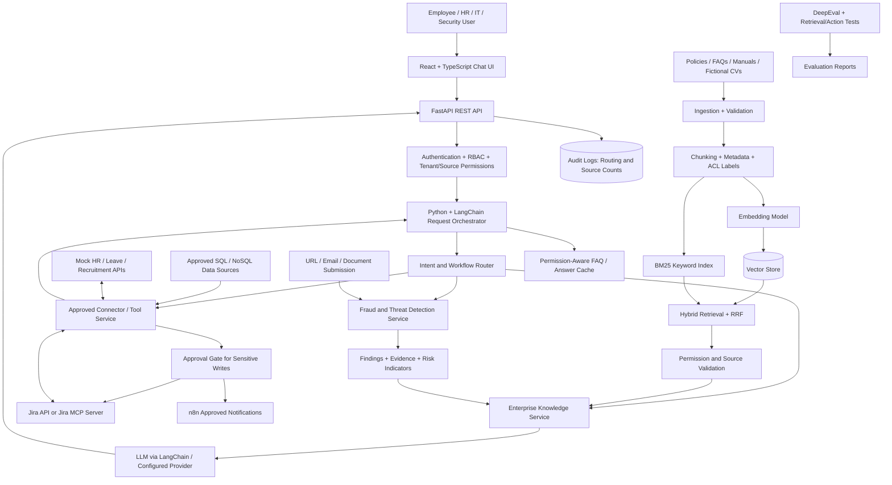

# KnowledgeOps AI --- Enterprise Knowledge and Intelligent Operations Platform

> **Document type:** High-Level Design (HLD) / evolving project README\
> **Status:** Phase 6 uses approved documents through the existing
> permission-aware ingestion pipeline. A live Jira Cloud integration is
> implemented and requires backend credentials. Mock HR, recruitment, and IT
> connectors are out of scope; production decisions remain pending.\
> **Version:** 0.2\
> **Last updated:** 2026-10-26

## Local application quick start

The application starts with a small, clearly labeled fictional Northstar
Works knowledge corpus under `data/fictional_demo/`. Its general, HR, IT, and
recruitment documents are access-scoped and intended only for local
demonstration. Add more authorized documents through the authenticated
knowledge-management interface. Follow the
[local identity setup](docs/LOCAL_IDENTITY_SETUP.md) to configure Keycloak.
The short Windows/PowerShell setup is:

1. From the repository root, install backend development dependencies:

   ```powershell
   python -m pip install -e ".[dev]"
   ```

   For runtime dependencies without the development test tools, use
   `python -m pip install -r requirements.txt`.

2. Create the local environment file from the example if it does not
   already exist, then edit `.env` as needed:

   ```powershell
   if (-not (Test-Path .env)) { Copy-Item .env.example .env }
   ```

   The backend loads the repository-root `.env` automatically at startup.
   Existing process environment variables take precedence. Keep credentials
   in `.env` or a secret manager; never add them to `.env.example`.

3. Configure the frontend OIDC client:

   ```powershell
   if (-not (Test-Path frontend\.env.local)) {
       Copy-Item frontend\.env.example frontend\.env.local
   }
   ```

4. Start the backend in that terminal:

   ```powershell
   python -m uvicorn backend.app.main:app --reload
   ```

5. In a second terminal, start the frontend:

   ```powershell
   Set-Location frontend
   npm ci
   npm run dev
   ```

6. Open the Vite URL, sign in through the configured OIDC provider, and
   upload documents you are authorized to process.

## Phase 6: Verify fictional and uploaded scoped knowledge

The running application preloads synthetic examples from
`data/fictional_demo/`. They describe the invented Northstar Works and are
not real company policies. The corpus lets users try scoped HR, IT,
recruitment, and general questions immediately. Do not treat these examples
as real operational advice.

Example questions:

- Employee: “How should I handle an unexpected multi-factor prompt?”
- HR user: “How many working days of annual leave does a full-time employee
  receive?”
- IT support: “What should I do if the training account is locked?”
- Recruiter: “What skills does the fictional Platform Support Analyst
  campaign ask applicants to demonstrate?”

For additional material, an authorized knowledge manager can upload
owner-approved documents through **Knowledge assistant → Knowledge
documents**. Do not process real company or personal data until identity,
storage, and model-provider approvals are in place.

For each document:

1. Select the access scope that matches the approved audience: `hr`,
   `recruitment`, `it`, or `general`. The scope is enforced by the backend
   before retrieval, not just by the interface.
2. Enter an accurate title and upload a supported document. The upload is
   security-inspected and extracted text is chunked and stored for search.
3. Sign in as a user with that scope, ask a question answerable from the
   document, and verify the response cites its title, section, and source.
4. Sign in as a user without that scope and ask the same question. Verify
   the restricted document is absent from the returned citations and its
   restricted content is not included in the answer.
5. Uploaded documents appear in the stored-document list. The built-in
   fictional seed documents are source files under `data/fictional_demo/`;
   their citations identify the title and relative source path.

OIDC group mappings must grant `knowledge:manage` to upload or delete
documents, and `chat:ask` plus the relevant `knowledge:read:<scope>`
capability to retrieve them. Synthetic scope-isolation and citation tests
can be run without uploading organization documents:

```powershell
python -m pytest tests\unit\test_knowledge_documents.py tests\unit\test_knowledge_chat.py -q
```

To run the regression tests and deterministic evaluation, use separate
commands from the repository root:

```powershell
python -m pytest -q
```

The Phase 9 synthetic smoke report can be run with:

```powershell
python -m backend.app.evaluation.run_demo_evaluation
```

It reports retrieval MRR@3 and expected-source hit rate, routing accuracy,
restricted-scope denials/leaks, and synthetic threat-detection metrics. These
are repeatable fixture results, not production quality claims; answer
faithfulness/relevancy and latency/error evaluation remain future work.

The `.env.example` file documents configuration names and can be copied to
`.env`. Mock connector routes are enabled only by isolated automated tests.
Authenticated users mapped to `threat_scans:scan` can use the local
threat-analysis workspace.

Dense retrieval uses local embedded Qdrant with Ollama embeddings. Install
and start Ollama, ensure the configured models are available, and retain the
default settings in `.env`:

```powershell
ollama pull nomic-embed-text
ollama pull llama3.2:3b
```

For hosted chat generation using synthetic-only content, select Groq or
Mistral and explicitly set `AI_DATA_CLASS=synthetic`. Set `GROQ_API_KEY` or
`MISTRAL_API_KEY` in the local `.env`; never put secret values in tracked
files. Groq is a chat provider only here; Ollama or Mistral can provide
embeddings. Add these settings to `.env` for Groq:

```dotenv
RAG_BACKEND=qdrant
RAG_EMBEDDING_PROVIDER=ollama
RAG_GENERATION_BACKEND=groq
AI_DATA_CLASS=synthetic
GROQ_API_KEY=
```

For Mistral chat and embeddings, set `RAG_GENERATION_BACKEND=mistral` and
`RAG_EMBEDDING_PROVIDER=mistral`; configure `MISTRAL_API_KEY`. Mistral
embedding and chat model IDs can be selected with
`MISTRAL_EMBEDDING_MODEL` and `MISTRAL_CHAT_MODEL`; Groq's chat model is set
with `GROQ_CHAT_MODEL`. Chat requests and retrieved evidence are sent to the
selected hosted provider, and Mistral embeddings send indexed document text
and queries to Mistral. The application fails closed unless
`AI_DATA_CLASS=synthetic` is explicitly set. This is an operator assertion,
not automatic detection: use only generated synthetic documents and synthetic
questions with hosted providers.

The default Ollama models can be downloaded locally with
`ollama pull nomic-embed-text` and `ollama pull llama3.2:3b`. LangChain uses
Ollama for embeddings and chat generation; embedded Qdrant persists vectors
under `data/runtime/`. The chat model receives only scope-filtered retrieved
chunks, is instructed to treat them as untrusted evidence, and must cite
source labels. If retrieval finds no evidence, the model is not called and
the API returns an abstention. If Ollama is unavailable or the model is
missing, the request fails rather than silently substituting a template.
The default remains the local lexical retriever and deterministic answer
template when `RAG_BACKEND=local`; the checked-in `.env.example` selects
Qdrant and Ollama. The backend loads `.env` automatically, and process
environment values take precedence.

For local OIDC with Keycloak, see the
[local identity setup](docs/LOCAL_IDENTITY_SETUP.md). The active application
requires provider-issued bearer tokens and maps configured groups to
allowlisted capabilities.

## Current implementation and limitations

The running application uses OIDC authentication, permission-filtered
document retrieval, local JSON persistence for document metadata and extracted
chunks, optional embedded Qdrant vectors, source citations, a stateless chat
interface, an authenticated system-status panel, and an optional live Jira
Cloud workspace. Chat requests and answers are not persisted or carried into
later requests. The Jira integration uses a backend-only service-account
token; search requires `jira:read`, and issue changes require `jira:approve`
plus an explicit confirmation. Knowledge, audit, and other application
records remain local JSON for now. Users with
`knowledge:manage` can upload PDF, DOCX, TXT, Markdown, HTML, XLSX, and PPTX
documents. The active corpus includes clearly fictional seed documents and
any authorized uploaded documents. Fictional fixtures and mock connector
implementations are not exposed by the application; Jira Cloud is a separate
real integration. Current
contracts are documented in [API.md](docs/API.md)
and system boundaries in [ARCHITECTURE.md](docs/ARCHITECTURE.md). The HLD
below is retained as future-scope reference; its fictional examples and older
prototype assumptions do not describe active runtime behavior. Production
identity, source, provider, retention, and deployment decisions remain
subject to approval.

The optional Jira issue-created notification to n8n is configured separately;
see [N8N_SETUP.md](docs/N8N_SETUP.md).

## 1. Project Overview

KnowledgeOps AI is a unified enterprise assistant that lets authorised
employees ask questions across approved company knowledge sources and
perform controlled actions from one chat interface. It combines
**enterprise knowledge retrieval as the core capability** with an
integrated **fraud and threat-detection module**.

The system connects company policies, HR guidance, recruitment
requirements, CVs, technical manuals, troubleshooting guides, approved
databases, and Jira information through a permission-aware orchestration
layer. Employees ask a question in natural language. Python and
LangChain help interpret the request, select the correct retrieval path
or tool, retrieve evidence, and return an answer with source references.

Examples include:

-   "How many annual leave days do I receive, and who approves my
    leave?"
-   "Where do I submit a leave request?"
-   "Find the internal policy that explains how we handle customer
    data."
-   "Summarise the troubleshooting steps for a Salesforce login
    problem."
-   "Which open Jira issues are assigned to the AI team?"
-   "Create a Jira bug for this issue and notify the responsible team."
-   "For this recruitment requirement, how many fictional CVs meet the
    criteria?"
-   "What success fee applies under the approved recruitment agreement?"
-   "Scan this URL, email, or document for suspicious indicators."

**KnowledgeOps AI is a proposed design, not a claim that every
integration has already been implemented.** Demonstrations use fictional
company data, mock connectors, and sample documents unless access to
real systems and information is explicitly authorised.

## 2. Problem Statement

Company information is often spread across document repositories, HR
systems, recruitment records, technical manuals, databases, and Jira.
Employees must know where to search, understand which information is
current, and contact the correct team when they need help. Generic
chatbots may return unsupported answers, while disconnected systems make
it difficult to turn an answer into an approved action.

KnowledgeOps AI brings these activities into one secure workflow:

1.  Authenticate the employee and determine their permissions.
2.  Understand the question and select the appropriate source or
    workflow.
3.  Search only the information that employee is allowed to access.
4.  Combine semantic and keyword retrieval.
5.  Answer from verifiable evidence and cite the sources.
6.  Offer a relevant action when available, such as opening a leave
    portal link or preparing a Jira issue.
7.  Require approval for sensitive or write operations.
8.  Record important decisions and actions for audit and
    troubleshooting.

## 3. Objectives

-   Build a React chat interface with authentication and role-aware
    navigation.
-   Build a Python FastAPI backend with LangChain-based request
    orchestration.
-   Answer enterprise questions using approved policies, technical
    documentation, FAQs, and connected systems.
-   Implement chunking, embeddings, vector search, BM25 keyword search,
    and hybrid rank fusion using Reciprocal Rank Fusion (RRF).
-   Return source references, document versions, and uncertainty when
    evidence is incomplete.
-   Support frequently asked questions and safely reuse prior answers
    when the underlying data and permissions permit it.
-   Connect to Jira for issue search and approval-gated issue creation.
-   Use n8n for approved notifications and follow-up workflows.
-   Integrate fraud/threat detection for suspicious URLs, emails, and
    documents as a separate service that can use the knowledge base for
    policy context.
-   Apply authentication, role-based access control (RBAC), least
    privilege, source-level permissions, audit logs, and approval gates.
-   Evaluate retrieval, answer grounding, action correctness, and
    threat-detection quality separately.
-   Demonstrate the platform with fictional company data unless real
    access is explicitly authorised.

## 4. Scope

### 4.1 Core: Enterprise Knowledge AI

-   Approved PDF, DOCX, TXT, CSV, and other explicitly configured
    document sources.
-   HR policies and FAQs, including leave rules and approval routes.
-   IT support guides, application manuals, and troubleshooting steps.
-   Customer-data handling and information-security policies.
-   Recruitment requirements and fictional CV matching for
    demonstrations.
-   Approved database and REST API connectors.
-   Jira issue search and details.
-   RAG with document metadata, citations, versioning, and access
    filtering.
-   Hybrid retrieval: vector search + BM25 + score/rank fusion.
-   LangChain orchestration and LLM answer generation using a configured
    provider such as Groq.
-   FAQ suggestions, repeated-question analytics, and carefully scoped
    answer caching.
-   A React/TypeScript frontend and FastAPI backend.

### 4.2 Integrated Fraud and Threat Detection

-   URL inspection for suspicious indicators.
-   Email analysis, including sender information, message content,
    embedded URLs, and attachments.
-   Document inspection for suspicious indicators and unsafe embedded
    content.
-   Rule-based checks and threat-intelligence lookups where configured.
-   ML classification when suitable data and evaluation are available.
-   Evidence-based findings and human-reviewed investigations.
-   Retrieval of relevant company security policies to explain
    recommended handling.
-   Jira case proposals and n8n notifications through authorised
    workflows.

Fraud/threat detection is a separate service from general knowledge
retrieval. It can use the same application, identity controls, audit
infrastructure, and approved knowledge sources, but it must not treat an
LLM-generated explanation as proof of fraud.

### 4.3 Out of scope for the first prototype

-   Unauthorised access to live company databases, employee records,
    CVs, or Jira.
-   Autonomous sensitive HR decisions, candidate rejection, employee
    discipline, or access changes.
-   Automatically accusing a person of fraud or taking enforcement
    action based only on a model score.
-   Unapproved write operations to company systems.
-   A claim that the platform already has live integrations before they
    are tested.
-   Treating a cached answer as current when the underlying policy,
    permissions, or connected data may have changed.

## 5. Example User Workflows

### Workflow A --- HR leave question

**Question:** "How many annual leave days do I receive, and who approves
my leave?"

1.  Authenticate the employee and load their permitted role and access
    scope.
2.  Classify the request as an HR-policy question.
3.  Retrieve the relevant current leave policy and FAQ using hybrid
    search.
4.  If required, query an approved HR API for employee-specific
    entitlement. Do not infer personal entitlement from a generic policy
    alone.
5.  Generate a concise answer with the policy name, version, section,
    and applicable conditions.
6.  Provide the authorised leave-management portal link or explain the
    approved submission steps.
7.  If the answer is not supported by current evidence, ask for
    clarification or direct the employee to HR rather than inventing a
    number.

### Workflow B --- Recruitment requirement and CV matching

**Question:** "For this recruitment campaign, how many CVs meet the
requirement?"

1.  An authorised HR user selects a fictional campaign and its job
    requirements.
2.  The system retrieves only CVs and recruitment data the user is
    permitted to view.
3.  It extracts relevant skills and experience and compares them with
    explicit job criteria.
4.  It reports the count, the criteria used, evidence for each match,
    and any uncertain or missing information.
5.  A human recruiter reviews the results. The system does not
    autonomously make final hiring decisions.

**Success-fee questions:** The system should retrieve the applicable
fictional contract or approved fee policy and use a transparent,
validated calculation only when the fee formula and required values are
present. It must show the formula and inputs. It must not invent a fee
or expose commercial terms to unauthorised users.

### Workflow C --- IT support and Jira

**Question:** "Summarise the troubleshooting steps for a Salesforce
login problem."

1.  Classify the request as IT support.
2.  Search approved Salesforce manuals, troubleshooting guides, and
    relevant permitted Jira issues.
3.  Return ordered troubleshooting steps with citations and applicable
    version details.
4.  If the user reports a new issue, collect the required fields and
    prepare a Jira bug proposal.
5.  Identify the responsible team using approved routing rules or Jira
    project/component ownership data.
6.  Show the proposed title, description, priority, project, and
    assignee/team to the user.
7.  Create the issue only after the required user approval and
    server-side permission checks.
8.  Trigger an n8n notification containing only the minimum information
    required.
9.  Report the actual Jira result. If a mock connector was used, label
    the result clearly as simulated.

### Workflow D --- Internal policy and customer data

**Question:** "Find the internal policy that explains how we handle
customer data."

1.  Check the user's identity and access permissions.
2.  Search the approved policy corpus using hybrid retrieval.
3.  Apply access filters before retrieved passages are passed to the
    LLM.
4.  Return a grounded summary with source, version, section, and
    effective date when available.
5.  If the policy is missing, expired, or contradictory, say so and
    route the question to the policy owner.

### Workflow E --- Fraud/threat investigation

1.  An authorised user submits a URL, email, or document for analysis.
2.  The threat service validates and safely processes the input.
3.  Rules, configured threat intelligence, and available ML models
    return indicators and evidence.
4.  Knowledge AI retrieves relevant security procedures or
    incident-response guidance.
5.  The assistant explains the findings without inventing evidence and
    marks uncertainty.
6.  An authorised user reviews the finding and may approve a Jira case
    or an n8n notification.

## 6. High-Level Architecture



### Architecture notes

-   **FastAPI is the application boundary.** The frontend must not
    connect directly to databases, vector stores, Jira credentials, or
    model-provider secrets.
-   **LangChain orchestrates; it does not grant permission.** The
    backend authorises each retrieval and tool call independently.
-   **The router selects a workflow** such as HR policy retrieval, IT
    troubleshooting, Jira search, recruitment analysis, or threat
    scanning. Use explicit routing rules and validated tool schemas; do
    not rely on unconstrained agent behaviour for sensitive actions.
-   **RAG retrieves knowledge, not authoritative live state.** For
    current Jira issues, leave balances, or campaign status, query the
    approved source system when configured.
-   **Hybrid search is the default retrieval design.** Combine semantic
    similarity with BM25 keyword matching, then use RRF or a measured
    fusion method. Evaluate it against a vector-only baseline.
-   **Access control applies before generation.** A prompt telling the
    LLM to hide restricted content is not a security boundary.
-   **Threat detection and knowledge retrieval remain separate
    modules.** Knowledge AI may explain a threat result using approved
    policy evidence, but it must not manufacture or override detection
    evidence.
-   **Integrations are labelled live, sandbox, or mocked.** A demo must
    never present mock data as a real company result.

## 7. Technology Stack

  -----------------------------------------------------------------------
  Layer                   Proposed technology     Purpose
  ----------------------- ----------------------- -----------------------
  Frontend                React, TypeScript, Vite Chat interface, source
                                                  display, FAQs, scan and
                                                  action review

  UI components           MUI or Tailwind CSS     Accessible and
                                                  consistent UI

  Backend                 Python, FastAPI,        REST API, validation,
                          Pydantic                authentication
                                                  integration

  Orchestration           LangChain               Workflow composition,
                                                  retrieval, LLM calls,
                                                  tool schemas

  LLM provider            Groq or another         Answer generation and
                          approved provider       explanations

  Document processing     PyMuPDF, python-docx,   Text and metadata
                          standard email parser,  extraction
                          safe text/CSV parsers   

  Embeddings              One selected embedding  Semantic retrieval
                          model                   

  Vector store            FAISS for local         Vector similarity
                          prototype; pgvector for search
                          shared persistence      

  Keyword search          BM25, e.g. `rank-bm25`  Exact terms, error
                                                  codes, names, issue
                                                  keys

  Rank fusion             Reciprocal Rank Fusion  Combine vector and BM25
                          (RRF)                   result rankings

  Relational data         PostgreSQL              Users, permissions,
                                                  metadata, actions,
                                                  audit events

  Optional flexible store MongoDB only if a clear Flexible records; not a
                          document/event use case default second database
                          requires it             

  Background jobs         Celery + Redis, if      Queues, retries,
                          long-running            resumable jobs
                          ingestion/scans require 
                          it                      

  Integrations            REST APIs and MCP       Jira and approved
                          client/server where     enterprise tools
                          available               

  Automation              n8n                     Approved notifications
                                                  and follow-up workflows

  Evaluation              DeepEval plus custom    RAG quality,
                          retrieval/action tests  faithfulness,
                                                  groundedness and
                                                  regression tests

  Threat detection        Python rules;           URL/email/document
                          scikit-learn models if  indicators and
                          justified               classification

  Observability           Structured logs,        Debugging, monitoring,
                          request IDs, metrics    auditability

  Version control         Git + GitHub            Code review and change
                                                  history
  -----------------------------------------------------------------------

**Database principle:** Connecting several systems does not mean copying
every source into one unrestricted database. Keep authoritative data in
its source where practical, store only necessary indexed copies,
preserve source ownership and access labels, and query live systems for
time-sensitive facts. Use PostgreSQL as the initial shared application
database; add MongoDB only when a demonstrated requirement justifies the
operational complexity. N.B for now we will be using JSON as part of our database , so design it in such a way that in
the later stage we will be able to configure databases

## 8. Request Orchestration and Workflow Routing

A typical request should follow this controlled sequence:

1.  **Authenticate:** Validate the session/token and identify the user.
2.  **Authorise:** Load role, team, permitted sources, and allowed
    actions.
3.  **Understand intent:** Identify whether the user needs a policy
    answer, live data, troubleshooting, recruitment analysis, threat
    scan, or an action.
4.  **Validate entities:** Extract and validate required details such as
    campaign ID, Jira project, issue key, application name, or document
    reference.
5.  **Choose workflow:** Route to the appropriate retrieval chain,
    approved connector, or detection service.
6.  **Retrieve evidence:** Use hybrid retrieval for knowledge and
    authorised APIs for live system state.
7.  **Validate evidence and permissions:** Filter inaccessible sources,
    check freshness, and detect missing or conflicting information.
8.  **Generate answer:** Provide the LLM only with the evidence the user
    may access; require citations and an explicit uncertainty response
    when evidence is insufficient.
9.  **Prepare action if requested:** Generate a proposed tool call with
    validated arguments; do not execute sensitive writes yet.
10. **Approval and execution:** Obtain required user approval, re-check
    permission server-side, execute through a constrained connector, and
    capture the actual response.
11. **Audit and respond:** Record the workflow, sources, versions,
    approval, and outcome without logging unnecessary sensitive content.

### Example intent routes

  --------------------------------------------------------------------------
  User request      Route             Data/evidence        Possible outcome
                                      required             
  ----------------- ----------------- -------------------- -----------------
  "How many annual  HR policy +       Current leave policy Answer with
  leave days do I   authorised HR     and, if              policy citation
  receive?"         entitlement API   personalised,        and relevant
                    if needed         authorised employee  caveats
                                      record               

  "Who approves my  HR policy / leave Approval rules for   Explain approver
  leave?"           workflow source   the employee's role  and portal steps
                                      or leave type        

  "Which open Jira  Jira connector    Current Jira query   Live list, or
  issues are                          and user permissions clearly labelled
  assigned to the                                          mock list
  AI team?"                                                

  "Explain this     IT knowledge +    Current              Ordered steps
  Salesforce login  optional Jira     troubleshooting      with sources
  error"            search            manual and relevant  
                                      permitted issues     

  "Create a bug and Jira action + n8n Required issue       Approved issue
  notify the team"  workflow          fields, routing      creation and
                                      rule, user approval  minimal
                                                           notification

  "How many CVs     Recruitment       Campaign criteria    Count, criteria,
  meet this         workflow          and authorised       evidence and
  campaign?"                          fictional/approved   uncertainty
                                      CVs                  

  "What is the      Contract/policy   Applicable           Formula and
  recruitment       retrieval +       agreement, fee       result only when
  success fee?"     validated         formula, required    supported
                    calculation       values and access    
                                      permission           

  "Scan this email  Threat            Email evidence,      Indicators,
  for phishing"     detection +       extracted links,     evidence,
                    security-policy   configured           uncertainty and
                    RAG               rules/intelligence   recommended
                                                           handling
  --------------------------------------------------------------------------

## 9. RAG and Hybrid Retrieval Design

### 9.1 Ingestion pipeline

1.  Load approved documents or data from configured connectors.
2.  Validate file type, size, content, source identity, and ingestion
    permissions.
3.  Extract text and useful metadata such as title, source ID, owner,
    version, effective date, section/page, and access labels.
4.  Normalise content without removing important identifiers, tables,
    policy numbering, error codes, or legal wording.
5.  Split content into chunks; compare a reliable baseline splitter with
    semantic chunking where useful.
6.  Generate embeddings using a consistent, versioned embedding model.
7.  Store vectors and chunk metadata in the selected vector store.
8.  Build a BM25 index over the same authorised corpus.
9.  Keep document version, source location, and access rules available
    through retrieval.
10. Re-index or invalidate affected chunks when a source is updated or
    access is revoked.

### 9.2 Hybrid retrieval

1.  Run vector similarity search for semantic meaning.
2.  Run BM25 for exact phrases, policy IDs, error codes, names, Jira
    keys, and other literal terms.
3.  Merge rankings using Reciprocal Rank Fusion (RRF) or another
    evaluated method.
4.  Apply source permissions and freshness/version rules before context
    reaches the LLM.
5.  Optionally rerank a small candidate set if evaluation shows a
    measurable benefit.
6.  Return source metadata alongside every chunk so the UI can show
    citations.

Hybrid retrieval is a design choice to test, not a guarantee that every
answer will improve. Keep a fixed test set and compare vector-only
versus hybrid retrieval under the same conditions.

### 9.3 Grounded answer contract

A knowledge answer should include, where relevant:

-   A direct answer to the user's question.
-   Source title and source system.
-   Document version/effective date and section/page if available.
-   A link to the source or approved portal.
-   Any conditions, exceptions, or conflicting evidence.
-   A clear statement when the answer is not supported by available
    sources.

The LLM must not invent policy values, annual leave days, candidate
qualifications, Jira issue status, ownership, or success-fee amounts.
Current facts should be queried from the authoritative system when
possible.

## 10. FAQs, Repeated Questions and Answer Reuse

The system can identify frequent questions and suggest them in the chat
interface. For example, users might select "How do I request annual
leave?" or "How do I troubleshoot Salesforce login?"

Recommended approach:

1.  Store question patterns and usage counts without unnecessarily
    exposing personal conversation content.
2.  Curate common questions into an approved FAQ catalogue with owners
    and review dates.
3.  Use semantic similarity to suggest an existing FAQ when a new
    question is similar.
4.  Re-run retrieval and permission checks for each user; do not assume
    that because another person received an answer, everyone may see it.
5.  Cache only when the result is safe to reuse. Cache keys should
    account for user/permission scope, source version, locale where
    relevant, and workflow parameters.
6.  Use short TTLs or explicit invalidation for answers dependent on
    changing policies or live systems.
7.  Never cache personal leave balances, private CV details, or
    permission-dependent Jira data in a shared cache without a strict
    isolation design.
8.  Track helpfulness and failed searches to improve the FAQ catalogue.

Repeated questions can reduce unnecessary generation cost and improve
response time, but **a previous answer is not automatically
authoritative or current**.

## 11. Identity, RBAC and Information Security

### 11.1 Example roles

  -----------------------------------------------------------------------
  Role                                Typical access (illustrative only)
  ----------------------------------- -----------------------------------
  Employee                            General policies and IT guidance;
                                      own permitted requests

  HR user                             HR policies and authorised
                                      recruitment/employee workflows

  Recruiter / HR manager              Approved recruitment campaigns and
                                      CVs for assigned campaigns

  IT support                          Technical manuals, support queue,
                                      and issues permitted for their team

  Security analyst                    Threat scans, security policies,
                                      and assigned investigations

  Team manager                        Team-specific dashboards and
                                      actions explicitly granted

  Administrator                       User/role configuration and system
                                      operations; access is still audited
  -----------------------------------------------------------------------

These roles are examples. Actual permissions must be approved by the
organisation and enforced by the backend, not inferred from names such
as "manager" or "administrator."

### 11.2 Security controls

-   Authenticate users before exposing company data or tools.
-   Enforce RBAC and least privilege for every API request and tool
    call.
-   Apply document-level and source-system permissions during retrieval,
    not only in the frontend.
-   Use OAuth/SSO where available; otherwise implement a secure, tested
    authentication approach.
-   Store credentials in environment variables or a secrets manager,
    never in Git.
-   Use TLS in transit and appropriate encryption at rest.
-   Validate uploaded files, URLs, connector inputs, and tool arguments.
-   Protect against prompt injection in documents, emails, CVs, Jira
    issue descriptions, and URLs. Treat retrieved content as untrusted
    data, not as instructions.
-   Keep LLM prompts from bypassing authorisation or approving actions.
-   Require explicit approval for Jira creation and other sensitive
    write actions.
-   Re-check permissions immediately before a write action.
-   Record who initiated and approved each action, what was proposed,
    and the actual result.
-   Minimise personal data in logs, prompts, caches, and third-party
    model requests.
-   Define retention, deletion, and access-revocation behaviour.
-   Do not send confidential company data to external LLM providers
    without explicit organisational approval and an appropriate
    data-handling configuration.
-   Use fictional data in demos and tests unless real-system access is
    explicitly authorised.

## 12. Integrated Fraud and Threat Detection

This module is separate from the general enterprise Q&A workflow but can
use Knowledge AI to retrieve security policies and explain its findings.

### Current implementation

- **Pre-ingestion inspection:** uploaded bytes receive a static preflight
  before document parsers run. Extracted text is then scanned before chunks
  are indexed or sent to an embedding provider. High-severity credential and
  key indicators block ingestion by default (`THREAT_INGESTION_BLOCK_SEVERITY=high`).
  Lower-severity indicators create alerts and remain ingestible unless the
  operator raises the threshold.
- **Interactive scans:** authorized security analysts can inspect URLs,
  pasted email, and pasted `.txt`, `.md`, or `.eml` text in **Threat analysis**.
  URL checks are local and never fetch submitted URLs.
- **Application event monitoring:** the audit pipeline counts repeated
  authentication and authorization denials in a configurable in-process time
  window and creates an alert when the threshold is reached.
- **Alert review:** security analysts can list, acknowledge, resolve, or mark
  alerts as false positives. Alerts preserve rule IDs, explanations, severity,
  detector version, actor, and (for uploads) a SHA-256 fingerprint. Matched
  secret values, submitted text, and uploaded filenames are not included in
  alert records.
- **n8n:** an optional authenticated outbound webhook sends minimal alert
  metadata. Delivery success/failure appears on the alert. An analyst can
  acknowledge and explicitly confirm a response-workflow dispatch. The app
  does not accept inbound n8n commands or automatically remediate or create
  Jira issues. A separate optional Jira webhook can notify after a confirmed
  issue is created; it sends only the event, issue key, project key, and Jira
  URL.

To test document blocking, ingest a harmless synthetic TXT containing
`api_key = fictionalSecretValue983721`; the upload should return HTTP 422,
create a redacted alert, and add no document to the index. To test a
lower-severity review alert, ingest a synthetic document labelled
`STRICTLY CONFIDENTIAL`; by default it is stored with a security alert for
review. For interactive scans, see the harmless samples and limitations in
the Threat analysis panel.

### Configuration and limitations

Set `SECURITY_ALERTS_PATH` to an ignored runtime JSON path. Tune
`SECURITY_DENIAL_THRESHOLD`, `SECURITY_DENIAL_WINDOW_SECONDS`, and
`SECURITY_DENIAL_ALERT_COOLDOWN_SECONDS` for the expected local request rate.
Set `N8N_ALERT_WEBHOOK_URL` and optionally `N8N_ALERT_WEBHOOK_TOKEN` to enable
notifications; use HTTPS except for localhost development. Only alert
metadata and rule IDs are sent to n8n.
For Jira issue-created events, configure `N8N_JIRA_WEBHOOK_URL` and optionally
`N8N_JIRA_WEBHOOK_TOKEN`. Jira creation remains successful if the subsequent
notification fails; the API response reports the notification outcome.

These are deterministic indicators, not antivirus, malware detonation,
external reputation, or a full DLP classifier. The event window is
in-process and resets on backend restart; alerts themselves are stored in the
existing JSON persistence pattern. A no-indicator result is not proof of
safety. Production use requires approved retention, monitor thresholds,
external service controls, and security operations procedures.

### 12.1 Inputs and analysis

-   **URLs:** validate and normalise the URL and inspect deterministic
    indicators such as numeric-IP hosts, punycode, non-HTTPS schemes, and
    sensitive account-related path terms. No reputation lookup, redirect
    handling, or network request is performed.
-   **Emails:** inspect pasted RFC-style headers and plain-text body for
    sender/reply-to mismatches, credential or urgency language, and URLs.
    Attachment names may be noted; attachment contents are not read.
-   **Documents:** inspect pasted text labelled `.txt`, `.md`, or `.eml`
    for known indicators and URLs. Binary upload, file extraction,
    metadata analysis, and malware scanning are not implemented.
-   **Detection:** deterministic local rules are active. Threat
    intelligence and ML classifiers are not connected.

### 12.2 Safe processing

-   The active scanner does not accept binary uploads, execute
    documents/attachments, or fetch URLs.
-   URL fetching, external reputation services, and binary parsing must
    not be added without SSRF controls, isolated resource-limited
    processing, timeouts, and network-egress restrictions.
-   Treat reputation no-match as unknown, not proof of safety.
-   Keep evidence, rule/model version, timestamp, and limitations with
    every finding.

### 12.3 Result and human review

A scan result includes the artifact type and fingerprint, verdict
(`suspicious` or `no-known-indicator`), severity, matched rule evidence,
detector version, scan time, and limitations. Confidence is not calibrated
and is not reported. A scan verdict is not a final legal conclusion. The
LLM may explain evidence and retrieve relevant policy but must not create
evidence or independently overrule the detector.

### 12.4 Evaluation

Use precision, recall, F1, false-positive rate, confusion matrix, and
precision-recall AUC when suitable labelled data exists. Evaluate RAG
with DeepEval separately. Use safe synthetic fixtures and approved test
files; do not use live malicious artifacts in an ordinary demo.

## 13. Jira MCP and n8n

### 13.1 Jira capabilities

Initial capabilities may include: - Search issues with validated,
permission-scoped queries. - Retrieve issue details the user is allowed
to view. - Propose a bug or support issue. - Route the proposal to an
approved project/component/team. - Create the issue only after explicit
approval. - Return the actual issue key and result.

Security requirements: - Use a dedicated integration identity with
minimum permissions. - Validate project, issue type, priority,
description, and assignment fields server-side. - Prevent arbitrary JQL
or tool arguments from bypassing permissions. - Treat Jira text as
untrusted content. - Log requester, approver, action, timestamp, and
result. - Use a clearly labelled mock adapter if live access is
unavailable.

### 13.2 n8n notifications

Start with one narrowly scoped workflow, such as notifying the IT
support team after an approved Jira bug is created or notifying security
after an authorised threat finding is escalated.

-   Use authenticated webhooks and validate incoming payloads.
-   Send only the minimum necessary data.
-   Do not send full CVs, HR records, customer data, or sensitive
    documents by default.
-   Make the outcome visible in logs.
-   Distinguish a test notification from a real notification.

## 14. Data Model (Initial)

Use relational tables for identity, source metadata, permissions, actions,
and auditability. Keep original data in source systems where practical. The
prototype does not persist individual chat sessions or messages; every chat
request is independent.

  ------------------------------------------------------------------------
  Entity                  Purpose                 Example fields
  ----------------------- ----------------------- ------------------------
  `users`                 Authenticated users     `user_id`,
                                                  `external_subject`,
                                                  `status`

  `roles` / `user_roles`  Role assignment         `role_id`, `user_id`,
                                                  `scope`

  `sources`               Connected systems and   `source_id`,
                          repositories            `source_type`, `owner`,
                                                  `status`

  `documents`             Source document         `document_id`,
                          metadata                `source_id`, `title`,
                                                  `version`,
                                                  `effective_at`,
                                                  `access_policy`

  `document_chunks`       Searchable text         `chunk_id`,
                          segments                `document_id`, `text`,
                                                  `embedding_ref`,
                                                  `section`, `page`

  `faq_items`             Curated common          `faq_id`, `question`,
                          questions               `approved_answer_ref`,
                                                  `owner`, `review_date`

  `faq_usage`             Aggregated usage        `faq_id`, `period`,
                                                  `count`

  `connector_runs`        Ingestion/API sync      `run_id`, `source_id`,
                          history                 `status`, `started_at`,
                                                  `finished_at`

  `tool_actions`          Proposed and executed   `action_id`, `user_id`,
                          actions                 `tool_name`,
                                                  `approval_status`,
                                                  `result_ref`

  `audit_logs`            Security-relevant       `event_id`, `user_id`,
                          activity                `event_type`,
                                                  `timestamp`,
                                                  `request_id`

  `threat_scans`          URL/email/document scan `scan_id`,
                          metadata                `artifact_type`,
                                                  `status`,
                                                  `detector_version`,
                                                  `created_at`

  `threat_findings`       Detection evidence      `finding_id`, `scan_id`,
                                                  `category`, `severity`,
                                                  `evidence_ref`

  `evaluation_runs`       Evaluation execution    `run_id`,
                          metadata                `dataset_version`,
                                                  `component`, `metrics`,
                                                  `created_at`
  ------------------------------------------------------------------------

Recruitment and employee-specific records should either remain in
authoritative HR systems or use separate permissioned entities designed
with HR/security review. Do not place unrestricted CV text or employee
records into a globally accessible knowledge index.

## 15. API Sketch

These endpoints are a proposed design, not an implemented contract.
Final schemas, authentication, error handling, pagination, rate limits,
and permissions must be defined before coding.

  ----------------------------------------------------------------------------------------------
  Method                  Endpoint                                       Purpose
  ----------------------- ---------------------------------------------- -----------------------
  `GET`                   `/api/v1/health`                               Health check

  `GET`                   `/api/v1/me`                                   Current user and
                                                                         allowed capabilities

  `POST`                  `/api/v1/chat`                                 Ask a question and
                                                                         receive a grounded
                                                                         answer

  `GET`                   `/api/v1/faqs/suggestions`                     Suggest approved common
                                                                         questions

  `POST`                  `/api/v1/knowledge/ingestions`                 Start an authorised
                                                                         ingestion job

  `GET`                   `/api/v1/knowledge/sources`                    List sources visible to
                                                                         the user

  `POST`                  `/api/v1/connectors/jira/search`               Search authorised Jira
                                                                         issues

  `GET`                   `/api/v1/connectors/jira/issues/{issue_key}`   Get an authorised issue

  `POST`                  `/api/v1/actions/jira/proposals`               Prepare a Jira issue
                                                                         proposal

  `POST`                  `/api/v1/actions/{action_id}/approve`          Approve an eligible
                                                                         action

  `POST`                  `/api/v1/threat-scans/urls`                    Scan URLs

  `POST`                  `/api/v1/threat-scans/documents`               Scan documents

  `POST`                  `/api/v1/threat-scans/emails`                  Scan email files

  `GET`                   `/api/v1/threat-scans/{scan_id}`               Get scan status and
                                                                         results

  `POST`                  `/api/v1/evaluations/runs`                     Run evaluation suite

  `GET`                   `/api/v1/audit-events`                         Retrieve audit events
                                                                         permitted to the caller
  ----------------------------------------------------------------------------------------------

Connector-specific HR/recruitment endpoints should be added only after
source contracts and access rules are agreed. Do not expose unrestricted
database query endpoints to the LLM.

### Example chat response contract

``` json
{
  "answer": "The current policy states ...",
  "intent": "hr.leave_policy",
  "sources": [
    {
      "title": "Annual Leave Policy",
      "version": "demo-v1",
      "section": "4.2",
      "source_type": "fictional_document"
    }
  ],
  "needs_clarification": false,
  "action_proposal": null
}
```

This is illustrative fictional data, not a live policy answer.

## 16. Evaluation and Quality Assurance

Evaluate each component with tests that reflect its responsibility.

### Knowledge and RAG

-   Retrieval precision/recall at k, where reference evidence is
    available.
-   Contextual Precision, Contextual Recall, Contextual Relevancy.
-   Faithfulness and Answer Relevancy using DeepEval or an appropriate
    evaluation setup.
-   Citation correctness and source-version correctness.
-   Permission leakage tests: verify that restricted chunks never appear
    in retrieved context or answers.
-   Regression tests for policy changes, conflicting sources, missing
    evidence, and prompt injection.

### Orchestration and actions

-   Intent-routing accuracy across HR, IT, recruitment, Jira, and threat
    scans.
-   Tool selection and argument validation.
-   Correct handling of missing required fields.
-   Approval bypass tests and permission re-check tests.
-   Jira action success/failure reporting.
-   n8n payload validation and notification outcome.

### Threat detection

-   Precision, recall, F1, false-positive rate, confusion matrix, and
    PR-AUC when labels exist.
-   Evaluate URL, email, and document detectors separately where
    appropriate.
-   Report data limitations and avoid presenting uncalibrated scores as
    probabilities.

### FAQ and caching

-   Correct FAQ matching.
-   Cache invalidation after policy/source updates.
-   Cache isolation across users and roles.
-   No reuse of stale live data or personal results.

Use a versioned initial set of around 30--50 fictional enterprise
questions, with expected sources and expected behaviours. Report actual
test results; do not invent metrics.

## 17. Repository Structure (Proposed)

``` text
knowledgeops-ai/
├── README.md
├── .env.example
├── .gitignore
├── pyproject.toml
├── frontend/
│   ├── src/
│   │   ├── app/
│   │   ├── components/
│   │   ├── features/
│   │   │   ├── chat/
│   │   │   ├── faqs/
│   │   │   ├── sources/
│   │   │   ├── jira/
│   │   │   └── threat-scans/
│   │   ├── api/
│   │   ├── hooks/
│   │   └── types/
│   └── package.json
├── backend/
│   └── app/
│       ├── main.py
│       ├── api/v1/
│       ├── core/
│       │   ├── config.py
│       │   ├── auth.py
│       │   └── permissions.py
│       ├── orchestration/
│       ├── knowledge/
│       │   ├── ingestion.py
│       │   ├── chunking.py
│       │   ├── embeddings.py
│       │   ├── retrieval.py
│       │   └── generation.py
│       ├── connectors/
│       │   ├── base.py
│       │   ├── jira.py
│       │   ├── hr_demo.py
│       │   └── it_knowledge.py
│       ├── threat_detection/
│       │   ├── urls.py
│       │   ├── emails.py
│       │   ├── documents.py
│       │   ├── rules.py
│       │   └── evaluation.py
│       ├── actions/
│       ├── integrations/
│       │   ├── mcp_client.py
│       │   └── n8n.py
│       ├── evaluation/
│       ├── storage/
│       └── workers/
├── data/
│   └── fictional_demo/
│       ├── hr_policies/
│       ├── it_manuals/
│       ├── recruitment_campaigns/
│       ├── sample_cvs/
│       ├── jira_issues/
│       └── threat_test_fixtures/
├── tests/
│   ├── unit/
│   ├── integration/
│   ├── security/
│   └── evaluation/
└── docs/
    ├── ARCHITECTURE.md
    ├── API.md
    ├── DATA_MODEL.md
    └── DEMO.md
```

## 18. Implementation Phases

  -----------------------------------------------------------------------
  Phase                   Focus                   Exit criteria
  ----------------------- ----------------------- -----------------------
  1                       Requirements, fictional Authenticated app shell
                          data, repository, React and agreed API
                          and FastAPI skeleton    contracts

  2                       Core document ingestion Questions answered with
                          and baseline RAG        source citations

  3                       Hybrid retrieval and    Vector-only comparison
                          metadata/ACL filtering  and permission tests

  4                       LangChain routing, FAQ  Multiple intents route
                          suggestions              to the right workflow

  5                       Authentication, RBAC,   Role and
                          audit logs, secure      source-isolation tests
                          source access           pass

  6                       Mock HR, recruitment,   Leave, CV-match,
                          and IT connectors       success-fee, and
                                                  troubleshooting demos
                                                  use fictional evidence

  7                       Jira search,            Verified sandbox/mock
                          approval-gated actions, workflows and honest
                          n8n notifications       result reporting

  8                       Integrated              URL/email/document
                          threat-detection module scans return traceable
                                                  evidence

  9                       DeepEval, security      Regression and
                          tests, caching,         permission tests are
                          observability           repeatable

  10                      Hardening,              Teammate can reproduce
                          documentation,          the demo from setup
                          demonstration           instructions
  -----------------------------------------------------------------------

Adjust timing to team capacity and access to approved systems. Build a
small end-to-end vertical slice before adding every connector.

## 19. Demonstration Plan

Use only fictional company data unless real access has been explicitly
authorised.

1.  Log in as a fictional employee and ask about annual leave; show the
    cited policy and leave-portal guidance.
2.  Log in as a fictional IT support user and ask for Salesforce login
    troubleshooting; show manual references.
3.  Ask which open Jira issues belong to the AI team; show whether the
    connector is mock or sandbox.
4.  Request a Jira bug, review the proposal, approve it, and show the
    actual or simulated outcome.
5.  Log in as a fictional HR user; query a recruitment campaign, count
    CVs matching criteria, and show the evidence.
6.  Ask for a recruitment success fee; show the fictional agreement,
    formula, inputs, and calculation if fully supported.
7.  Ask about customer-data handling and show the approved policy
    reference.
8.  Submit a harmless URL/email/document fixture to the threat module
    and review its evidence.
9.  Trigger a test n8n notification and show the outcome.
10. Run the evaluation suite and show actual measured results.

## 20. Acceptance Criteria

The prototype is ready for demonstration when:

-   Users must authenticate before accessing protected functions.
-   Backend permissions restrict data and actions by role and source.
-   Knowledge answers cite permitted sources and acknowledge
    insufficient evidence.
-   Vector-only and hybrid retrieval can be compared on a fixed test
    set.
-   The chat router can distinguish the agreed HR, IT, recruitment,
    Jira, and threat-detection intents.
-   Frequently asked questions can be suggested without bypassing
    current retrieval or access checks.
-   The system does not leak restricted chunks through search, response
    citations, or caches; chat turns are not persisted.
-   HR, CV, and success-fee examples use fictional data unless approved
    access exists.
-   Jira writes require approval and are audited.
-   n8n receives only approved, minimal notification payloads.
-   Threat results include evidence and limitations and are not
    presented as final proof of fraud.
-   DeepEval/RAG, action-routing, security, and threat-detection tests
    are reported separately.
-   Mock integrations are clearly labelled.
-   Secrets and private company data are excluded from version control.
-   Another team member can follow the README to run the demonstration.

## 21. First Development Milestone

Build one reliable vertical slice:

1.  Create the React frontend and FastAPI backend.
2.  Add login/session handling and a basic role model.
3.  Create a small fictional knowledge corpus containing an annual leave
    policy, a Salesforce troubleshooting guide, a customer-data policy,
    a fictional recruitment agreement, and a few fictional CVs.
4.  Implement ingestion, metadata-aware chunking, embeddings, BM25,
    hybrid retrieval, and source citations.
5.  Add LangChain routing for HR policy and IT troubleshooting
    questions.
6.  Test that a role cannot retrieve a document outside its permission
    scope.
7.  Add a fictional FAQ list and permission-aware cache rules.
8.  Record test results and document the setup.

**Milestone 1 definition of done:** A signed-in fictional employee can
ask a question about an included policy and receive an answer with a
traceable source. A user with a different role cannot retrieve
restricted fictional HR/recruitment information. The application,
configuration, and evaluation steps are documented.

## 22. Design Decisions to Confirm

Before connecting real systems, agree on:

-   The identity provider and exact role/permission matrix.
-   Which HR, recruitment, document, database, and Jira sources are
    approved.
-   Whether the first shared database will be PostgreSQL with pgvector
    or PostgreSQL plus a separate local vector index.
-   Which embedding model and Groq/LLM configuration are approved for
    the data classification.
-   The authoritative source for leave entitlements, approval routing,
    recruitment criteria, and success-fee calculations.
-   Which actions require explicit approval and who can approve them.
-   What may be cached, for how long, and how policy/source changes
    invalidate answers.
-   Data retention, deletion, audit, and incident-handling requirements.
-   Which connectors are real, sandboxed, or mocked in the demo.

Do not mark any component "implemented" until it has been built, tested,
and its result verified.
